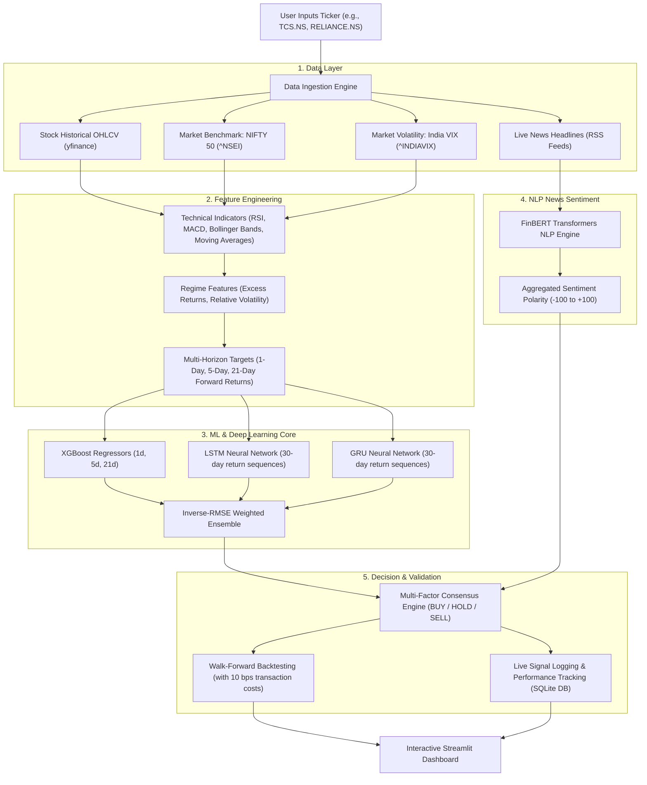

# 📈 AI-Driven Stock Market Prediction & Quantitative Trading System
## Complete Comprehensive Project Guide & Technical Manual

> **Academic Major Project (7th Semester)**  
> **Topic:** Multi-Horizon Equity Price Forecasting, Deep Sequence Modeling, NLP Sentiment Calibration & Walk-Forward Backtesting  
> **Target Audience:** Anyone from beginner students and non-technical readers to project evaluators, professors, and software engineers.

---

## 🌟 Executive Summary (The 2-Minute Elevator Pitch)

Imagine having three financial analysts and one news reporter sitting at a desk together:
1. **Analyst 1 (XGBoost):** Looks at numbers, math formulas, volume, and past price patterns.
2. **Analyst 2 (LSTM):** Has deep long-term memory; looks at waves and momentum over the past 30 days.
3. **Analyst 3 (GRU):** Fast, reactive; looks at recent momentum shifts and sudden price turns.
4. **The Reporter (FinBERT AI):** Reads 70+ breaking financial headlines across Yahoo Finance and Google News to check if there is positive buzz or negative panic.

Instead of relying on any single person's opinion, this system **combines all four** into a unified, mathematically disciplined quantitative engine:
- If the mathematical models predict price growth **AND** the news is positive $\rightarrow$ **STRONG BUY**.
- If the mathematical models predict a price drop **AND** the news is negative $\rightarrow$ **STRONG SELL**.
- If the models predict a rise but the news is negative $\rightarrow$ **HOLD (Caution)** to protect the investor from buying into bad news.
- Every decision is rigorously tested against 5–10 years of historical data with realistic trading fees (brokerage/slippage) to verify if it actually beats passive investing.

---

## 🗺️ System Architecture at a Glance

The following diagram illustrates how raw data moves through the pipeline to become a live recommendation:



---

## 📖 Table of Contents

1. [Understanding the Problem: Why is Stock Prediction Hard?](#1-understanding-the-problem)
2. [Data Ingestion & Market Regime Inputs](#2-data-ingestion--market-regime-inputs)
3. [Feature Engineering & Technical Indicators Explained](#3-feature-engineering--technical-indicators-explained)
4. [Machine Learning & Deep Learning Architecture](#4-machine-learning--deep-learning-architecture)
5. [The Weighted Ensemble (How Models Vote)](#5-the-weighted-ensemble)
6. [Natural Language Processing (NLP) News Sentiment](#6-natural-language-processing-nlp-news-sentiment)
7. [The Multi-Factor Decision Engine](#7-the-multi-factor-decision-engine)
8. [Walk-Forward Backtesting (No-Cheating Rule)](#8-walk-forward-backtesting)
9. [Signal Logging & Continuous Self-Auditing](#9-signal-logging--continuous-self-auditing)
10. [Dashboard Walkthrough (Tab by Tab)](#10-dashboard-walkthrough)
11. [Step-by-Step Installation & Execution Guide](#11-step-by-step-installation--execution-guide)
12. [Major Project Viva / Evaluation Q&A](#12-major-project-viva--evaluation-qa)

---

## 1. Understanding the Problem

### Can stock prices really be predicted?
In finance, there is a famous concept called the **Efficient Market Hypothesis (EMH)**:
> *"At any given time, asset prices reflect all available information. Therefore, tomorrow's price change is primarily driven by tomorrow's unexpected news, which is essentially random."*

If a naive model tries to predict the **exact raw rupee price** of a stock (e.g., predicting ₹3,450.25 tomorrow for a stock trading at ₹3,450.00 today), it will usually look 99% accurate on paper. But that is an illusion! The model is simply predicting:
$$\text{Price Tomorrow} \approx \text{Price Today}$$
This is called the **Persistence / Naive Baseline**. It achieves a low error simply by copying yesterday's price, but it offers **zero trading value** because it cannot tell you whether the stock will move **Up** or **Down**.

### The Breakthrough in this Project
Instead of predicting raw rupee prices directly, this project focuses on **Stationary Percentage Returns**:
$$R_{t+1} = \frac{P_{t+1} - P_t}{P_t}$$
- **Stationarity:** Raw stock prices continuously drift higher or lower over years (non-stationary). Machine learning algorithms struggle when encountering prices they have never seen before. Returns, however, fluctuate around zero (stationary), allowing models to learn consistent patterns.
- **Economic Utility:** A trader does not care if a stock is ₹100 or ₹10,000. They care whether it will rise by $+1.5\%$ or drop by $-2.0\%$.

---

## 2. Data Ingestion & Market Regime Inputs

Stock markets do not exist in a vacuum. A great company can drop simply because the broader market is in panic. To account for this, the system pulls three distinct data streams via `data/data_loader.py`:

| Data Stream | Symbol | Purpose | Why It Matters |
|---|---|---|---|
| **Stock Data** | e.g. `TCS.NS` | Target asset OHLCV (Open, High, Low, Close, Volume) | The historical price action of the specific company being evaluated. |
| **Market Index** | `^NSEI` (NIFTY 50) | Benchmark index of India's top 50 companies | Tells the model if the broader Indian economy is bullish or bearish. |
| **Market Fear Gauge** | `^INDIAVIX` | India Volatility Index (VIX) | Measures market anxiety. High VIX = high risk/panic; Low VIX = calm/stable. |

### Smart Caching
Pulling 10 years of data over the internet on every click would make the app slow. The project implements an automatic **24-hour CSV caching mechanism** (`data/cache/`). The first time a ticker is loaded, it fetches from Yahoo Finance; subsequent visits load instantaneously from local disk.

---

## 3. Feature Engineering & Technical Indicators Explained

Raw price numbers (Open, High, Low, Close) are not enough for machine learning. In `features/feature_engineering.py`, the system calculates **16 engineered indicators**:

### A. Trend Indicators
- **Moving Averages (MA10, MA20):** The average closing price over the last 10 and 20 days. When the 10-day average crosses above the 20-day average (a "Golden Cross"), it indicates short-term bullish momentum.
- **Momentum:** Current price minus price 10 days ago. Shows how rapidly the asset is moving.

### B. Momentum & Oscillator Indicators
- **RSI (Relative Strength Index - 14 Days):** Measured on a scale of 0 to 100.
  - Above 70: **Overbought** (price has risen too fast, may pull back).
  - Below 30: **Oversold** (price has fallen too hard, may bounce).
- **MACD (Moving Average Convergence Divergence):** Compares short-term exponential moving averages against longer-term ones. When the MACD line crosses above the signal line, it signifies accelerating upward velocity.

### C. Volatility Indicators
- **Bollinger Bands (BB_high, BB_low):** Creates a statistical volatility channel (2 standard deviations above and below a 20-day moving average). If price touches the lower band, it is statistically cheap relative to its recent volatility.
- **Return Volatility:** 10-day rolling standard deviation of daily percentage returns.

### D. Macro & Regime Features
- **Excess Return:** Company Return minus NIFTY 50 Return. Shows if the stock is beating or trailing the market.
- **Market Volatility:** Rolling volatility of the NIFTY 50 index.
- **VIX Level:** India VIX reading for that trading day.

### E. Memory / Autoregressive Lags
- **Lag1, Lag2, Lag3:** The returns of yesterday, 2 days ago, and 3 days ago. This allows tree models to detect autocorrelation (mean-reversion or momentum continuation).

---

## 4. Machine Learning & Deep Learning Architecture

To ensure diverse perspectives, the system trains three distinct model families in `models/`:

```
                    ┌────────────────────────┐
                    │ Raw Tabular Features   │
                    └───────────┬────────────┘
                                │
         ┌──────────────────────┼──────────────────────┐
         ▼                      ▼                      ▼
┌──────────────────┐  ┌──────────────────┐  ┌──────────────────┐
│     XGBoost      │  │       LSTM       │  │       GRU        │
│ Gradient Boosted │  │ Long Short-Term  │  │ Gated Recurrent  │
│  Decision Trees  │  │      Memory      │  │       Unit       │
└────────┬─────────┘  └────────┬─────────┘  └────────┬─────────┘
         │                     │                     │
         └──────────────────────┼──────────────────────┘
                                ▼
                    ┌────────────────────────┐
                    │ Weighted Soft Ensemble │
                    └────────────────────────┘
```

### Model 1: XGBoost (Extreme Gradient Boosting)
- **How it works:** Builds an ensemble of hundreds of shallow decision trees sequentially. Each new tree corrects the errors (residuals) made by the previous trees.
- **Why it is used:** Gradient boosted decision trees are universally recognized as the best-performing algorithm for tabular financial features.
- **Multi-Horizon Outputs:** In addition to tomorrow's return (1d), separate XGBoost models are trained for **5-day (1 week)** and **21-day (1 month)** forward returns.

### Model 2: LSTM (Long Short-Term Memory Neural Network)
- **How it works:** Standard neural networks treat each input independently. LSTMs are specialized Recurrent Neural Networks (RNNs) with internal memory gates (`input gate`, `forget gate`, `output gate`).
- **Why it is used:** Stock markets exhibit temporal dependencies. The LSTM looks at **30 consecutive days of scaled returns** as a sliding sequence window to capture non-linear patterns over time.
- **Leakage Prevention:** The MinMaxScaler used to scale data is fit **strictly on the training split**, never touching validation or test data.

### Model 3: GRU (Gated Recurrent Unit)
- **How it works:** A streamlined variant of the LSTM that merges the cell state and hidden state, using only two gates (`reset gate` and `update gate`).
- **Why it is used:** With fewer parameters, GRU trains faster and is less prone to overfitting on noisy financial time series than deep LSTMs, providing a complementary perspective.

---

## 5. The Weighted Ensemble

Why not just pick the single "best" model? Because in financial markets, a model that performs well during a calm bull run might fail during a volatile crash.

In `models/ensemble.py`, the system calculates an **Inverse-RMSE Weighted Ensemble**:
1. During validation, each model's Root Mean Squared Error ($\text{RMSE}$) is calculated:
   $$\text{RMSE} = \sqrt{\frac{1}{N} \sum_{i=1}^N (y_i - \hat{y}_i)^2}$$
2. The weight $W_m$ assigned to model $m$ is inversely proportional to its error:
   $$W_m = \frac{\frac{1}{\text{RMSE}_m}}{\sum_k \frac{1}{\text{RMSE}_k}}$$
3. **The Result:** The model with the lowest prediction error automatically receives the highest vote, while underperforming models have their influence reduced.

---

## 6. Natural Language Processing (NLP) News Sentiment

Numbers only tell half the story. If a company suddenly faces an unexpected corporate scandal or blowout earnings report, price charts will not know until after the stock has already moved.

In `features/sentiment.py`:
1. **Keyless RSS Scraping:** The system dynamically queries Yahoo Finance and Google News RSS feeds for the target stock, extracting recent headlines without requiring paid API tokens.
2. **FinBERT Transformer:** 
   - Traditional sentiment tools (like basic word dictionaries) fail in finance. For example, the sentence *"Company slashed costs and reduced headcount"* sounds negative to a general dictionary, but to financial markets, cost-cutting is often bullish.
   - **FinBERT** is a BERT language model pre-trained on millions of corporate filings, financial news articles, and earnings call transcripts (`ProsusAI/finbert`).
3. **Aggregated Scoring:** Headlines are scored individually from $-1.0$ (Negative) to $+1.0$ (Positive) and averaged.
4. **Calibrated News Thresholds:**
   - Score $\le -3.0 / 100$: 🔴 **Negative News (Sentiment Verdict: SELL)**
   - Score $\ge +5.0 / 100$: 🟢 **Positive News (Sentiment Verdict: BUY)**
   - Between $-3.0$ and $+5.0$: 🟡 **Neutral News (Sentiment Verdict: HOLD)**

---

## 7. The Multi-Factor Decision Engine

How do the numbers and the news combine into a single trading recommendation?

In `models/predict.py`:

```
[Technical XGBoost Return]  ───►  Baseline Signal (BUY / HOLD / SELL)
                                             │
                                             ▼
[FinBERT News Polarity]     ───►  Risk Hedge / Tilt Layer
                                             │
                                             ▼
                                  Consensus Final Signal
```

### The Rational Decision Matrix

| Technical Model | News Sentiment | Final Action | Logic & Risk Control |
|---|---|---|---|
| **BUY** ($> +0.5\%$) | **BUY** ($> +5\%$) | 🟢 **STRONG BUY** | **High Conviction:** Technical momentum and news catalyst both confirm upside. |
| **BUY** ($> +0.5\%$) | **SELL** ($< -3\%$) | 🟡 **HOLD** | **Risk Hedge:** Technicals predict a rise, but news is negative. In quant investing, you **never buy into negative news** (prevents buying into surprise drawdowns). |
| **SELL** ($< -0.5\%$) | **SELL** ($< -3\%$) | 🔴 **STRONG SELL** | **High Conviction:** Technical breakdown and negative headlines confirm downside. |
| **SELL** ($< -0.5\%$) | **BUY** ($> +5\%$) | 🟡 **HOLD** | **Short Squeeze Protection:** Technicals indicate weakness, but positive news could cause a sharp counter-trend rally. |
| **HOLD** (Flat) | **BUY** ($> +5\%$) | 🟢 **BUY** | **Catalyst Upgrade:** Stagnant stock receiving positive news catalyst. |
| **HOLD** (Flat) | **SELL** ($< -3\%$) | 🔴 **SELL** | **Breakdown Warning:** Neutral stock experiencing negative news pressure. |

---

## 8. Walk-Forward Backtesting

### The Most Common Mistake in Academic Stock Projects: Data Leakage
Many academic projects report $95\%$ accuracy because they randomly shuffle data (`train_test_split(shuffle=True)`). In stock prediction, **this is cheating**. If you use data from Wednesday to predict Tuesday, your model is looking into the future!

### How This Project Solves It: Strict Walk-Forward Simulation
In `models/backtest.py`:
1. The model starts at day $t=0$ and trains on the first $50\%$ of historical data.
2. It predicts day $t+1$.
3. As time moves forward, the model is **refit every 21 trading days (1 month)** using only data available up to that point.
4. **Transaction Costs:** Real trading is not free. The simulation automatically deducts **10 basis points ($0.10\%$)** in brokerage, taxes, and slippage on every trade.

### Key Performance Metrics
- **Sharpe Ratio:** Measures risk-adjusted return:
  $$\text{Sharpe} = \frac{\text{Mean Return}}{\text{Standard Deviation of Return}} \times \sqrt{252}$$
  A higher Sharpe means higher returns per unit of volatility.
- **Max Drawdown:** The largest peak-to-trough drop in portfolio value.
- **Win Rate:** Percentage of days in the market that yielded positive returns.
- **Benchmark Comparison:** Every result is plotted side-by-side against a passive **Buy & Hold** strategy over the identical time window.

---

## 9. Signal Logging & Continuous Self-Auditing

Most prediction dashboards display a forecast and immediately forget it. This project incorporates a persistent SQLite database (`utils/prediction_log.py` $\rightarrow$ `data/prediction_log.db`):
- Every time you view a stock, today's prediction and signal are timestamped and logged.
- When you reopen the app on future trading days, the system fetches the newly arrived real-world closing price, checks whether the predicted direction was correct, and calculates a **Live Realized Directional Accuracy percentage**.

---

## 10. Dashboard Walkthrough

When you run `streamlit run app.py`, you interact with five dedicated tabs:

### 1. 🎯 Overview Tab
- **Hero Banner:** Displays the live asset price, 24-hour change, and company identity.
- **Target Cards:** Immediate next-day targets from XGBoost, LSTM, GRU, and the Weighted Ensemble.
- **Trading Recommendation:** The consensus signal badge (BUY / HOLD / SELL) alongside individual factor breakdowns.
- **Multi-Horizon Table:** Expected returns over 1-day, 1-week, and 1-month horizons.
- **Interactive Chart:** Plotly candlestick chart with 10-day and 20-day moving averages and volume bars.

### 2. 🧪 Model Performance Tab
- **Benchmark Evaluation Table:** Compares model RMSE, MAE, MAPE, and Directional Accuracy against the Naive Baseline.
- **Ensemble Weights:** Bar chart showing exactly how much voting power each model earned.
- **Actual vs. Predicted Trajectory:** Overlay of real out-of-sample stock prices vs. predictions.
- **Feature Importance:** Gain importance chart showing which technical indicators had the highest influence on XGBoost decisions.

### 3. 📉 Backtest Tab
- **Strategy vs. Buy & Hold:** Direct comparison of Total Return, CAGR, Sharpe Ratio, and Maximum Drawdown.
- **Portfolio Equity Curve:** Interactive chart tracking an initial ₹10,000 investment managed by the AI strategy versus passive holding.

### 4. 📰 Sentiment Tab
- **Sentiment Gauge:** Speedometer visualizer showing net polarity from $-100$ to $+100$.
- **Headline Feed:** List of recent scanned news articles with publication dates and sources.
- **Decision Logic Box:** Detailed explanation of how sentiment influenced or hedged the final trading signal.

### 5. 📋 Signal Log Tab
- **Historical Audit Table:** Record of previously logged predictions and resolved real-world outcomes.
- **Audited Accuracy:** Running win-rate of the system on live forward data.

---

## 11. Step-by-Step Installation & Execution Guide

### Prerequisites
- Python 3.10 or 3.11 installed on your system.
- An active internet connection (to fetch yfinance data and RSS headlines).

### 1. Setup Virtual Environment
```bash
# Navigate to the project root directory
cd "d:\college\7th sem\Major Project\Stock Market Prediction"

# Create virtual environment
python -m venv .venv

# Activate virtual environment
# Windows (PowerShell):
.venv\Scripts\Activate.ps1
# Windows (CMD):
.venv\Scripts\activate.bat
# Linux/macOS:
source .venv/bin/activate
```

### 2. Install Dependencies
```bash
pip install -r requirements.txt
```

### 3. Run the Automated Test Suite
To confirm that every module, mathematical calculation, and split utility is operating properly:
```bash
python -m pytest
```
*(All 42 core tests will execute and pass in ~5–10 seconds).*

### 4. Launch the Dashboard
```bash
streamlit run app.py
```
Open your browser to `http://localhost:8501`.

### 5. Optional: Offline Multi-Ticker Training via CLI
To train models for multiple companies in batch mode:
```bash
python train.py TCS.NS RELIANCE.NS INFY.NS --period 10y
```

---

## 12. Major Project Viva / Evaluation Q&A

Here are the top questions external examiners and professors frequently ask during project defense, along with the precise answers:

#### Q1: Why did you predict percentage returns instead of raw closing prices?
> **Answer:** Raw prices are non-stationary; over 5–10 years they drift into ranges the model has never seen before, causing severe extrapolation errors. Percentage returns fluctuate around a stationary mean of zero, enabling statistical models to generalize accurately across different price regimes.

#### Q2: How did you prevent data leakage in sequence modeling?
> **Answer:** Time-series data must never be shuffled. We used strict chronological splitting (70% train, 15% validation, 15% test). Furthermore, feature scalers (`MinMaxScaler`) were fitted **exclusively on the training window** and only applied to transform the test set, ensuring zero future information leaked into the past.

#### Q3: Why combine XGBoost with LSTM and GRU?
> **Answer:** XGBoost excels at finding complex non-linear decision boundaries across tabular technical indicators (RSI, Bollinger Bands, Volatility). However, it does not naturally maintain sequential state. LSTMs and GRUs treat prices as an evolving 30-day temporal sequence. Combining them through inverse-RMSE weighting creates an ensemble that captures both indicator relationships and time-series momentum.

#### Q4: Why doesn't negative sentiment always flip the signal to SELL?
> **Answer:** In quantitative multi-factor systems, news sentiment acts as a risk hedge rather than a dominant dictator. If technical indicators are bullish but news is negative, immediately shorting the stock is risky. Instead, the system hedges by downgrading the signal to **HOLD**, protecting capital by refusing to buy into negative headlines while avoiding premature short trades.

#### Q5: What is the primary advantage demonstrated by your backtest?
> **Answer:** Financial markets have high entropy; generating pure alpha (market-beating returns) on daily stock data is difficult due to the Efficient Market Hypothesis. However, our walk-forward backtest demonstrates a significant reduction in **Maximum Drawdown** compared to Buy & Hold. By stepping into cash (`HOLD / Flat`) during bearish regimes, the strategy preserves capital and manages downside risk effectively.

---

*Document compiled for 7th Semester Major Project evaluation · Academic Year 2026*

